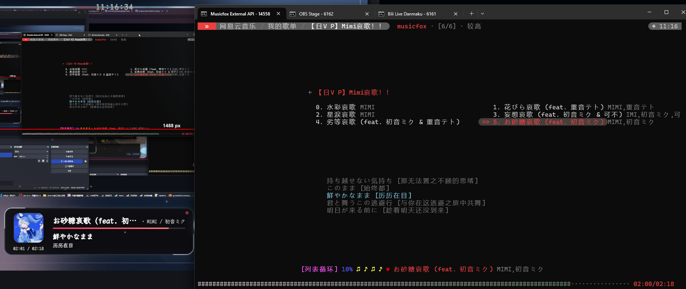

# go-musicfox (VincentZyu Fork)

<p align="center">
  
</p>

> [!TIP]
> 这是 VincentZyu 的 fork 版本，并增加 SPlayer-Next 兼容 HTTP/WS API。
> 上游 PR 保持原版视觉与最小改动。

[点击跳转到阅读上游仓库 README →](https://github.com/go-musicfox/go-musicfox#readme)

## 效果预览



## 常用快捷键速查

> [!TIP]
> 输入法为中文时同样支持直接敲击对应标点按键；在终端内随时按 `?` 可查看完整键位帮助。

### 播放控制

| 快捷键 | 功能说明 |
| :--- | :--- |
| `Space` | 播放 / 暂停 |
| `]` / `[` | 下一首 / 上一首（中英文括号 `]` `[` `】` `【` 均可） |
| `v` / `X` | 快进 5 秒 / 快退 5 秒 |
| `=` / `-` | 增加音量 / 减小音量 |
| `p` / `P` | 切换播放模式（单曲/随机/顺序/无限随机）/ 心动模式 |

### 列表导航

| 快捷键 | 功能说明 |
| :--- | :--- |
| `Enter` / `n` | 播放选中歌曲 / 进入下一级菜单 |
| `Esc` / `b` | 返回上一级菜单 |
| `j` / `k` (或方向键 `↓` `↑`) | 光标下移 / 光标上移 |
| `Ctrl+d` / `Ctrl+u` | 列表向下翻页 / 向上翻页 |
| `/` | 搜索当前列表 |

### 曲目与收藏操作

| 快捷键 | 功能说明 |
| :--- | :--- |
| `,` / `.` | 喜欢当前播放曲（红心 ♥）/ 取消喜欢 |
| `` ` `` / `~` | 将当前播放曲加入歌单（收藏夹）/ 从歌单中移除 |
| `<` / `>` | 喜欢选中歌曲 / 取消喜欢 |
| `Tab` / `Shift+Tab` | 将选中歌曲加入歌单（收藏夹）/ 从歌单中移除 |
| `;` / `'` | 收藏选中歌单 / 取消收藏歌单 |
| `m` / `M` | 弹出选中项操作菜单 / 弹出当前播放曲操作菜单 |
| `c` | 查看当前播放列表 |

### 鼠标交互

| 操作 | 功能说明 |
| :--- | :--- |
| **鼠标右键** | 任意位置呼出图形化上下文菜单（切歌、切换主题、列表操作） |
| **鼠标点击** | 底部播放栏支持点击切模式、暂停、喜欢红心、跳转歌手，进度条支持拖动快进 |

## 构建与全局安装

需要 Git、Go 1.26+ 和 C 编译器，并将示例路径替换为实际目录。

### Windows

```powershell
# 从 https://go.dev/dl/ 安装 Go 1.26+，并确保已安装 C 编译器（如 MinGW-w64）
git clone https://github.com/VincentZyuLive/go-musicfox-vincentzyu-fork.git
cd go-musicfox-vincentzyu-fork
powershell -NoProfile -ExecutionPolicy Bypass -File .\hack\build.ps1 build -BuildTags "enable_global_hotkey,purego"
$InstallDir = "D:\path\to\musicfox-vincentzyu-fork"
New-Item -ItemType Directory -Force $InstallDir | Out-Null
Copy-Item .\bin\musicfox.exe "$InstallDir\musicfox-vincentzyu-fork.exe" -Force
# 将 $InstallDir 加入用户 PATH，并重新打开终端
musicfox-vincentzyu-fork --version
```

### Debian / Ubuntu

```bash
sudo apt update
sudo apt install -y git build-essential libflac-dev libasound2-dev
# 从 https://go.dev/dl/ 安装 Go 1.26+，确保 go 命令在 PATH 中
git clone https://github.com/VincentZyuLive/go-musicfox-vincentzyu-fork.git
cd go-musicfox-vincentzyu-fork
BUILD_TAGS="enable_global_hotkey,purego" ./hack/build.sh build
INSTALL_DIR="/path/to/musicfox-vincentzyu-fork"
sudo install -Dm755 bin/musicfox "$INSTALL_DIR/musicfox-vincentzyu-fork"
# 将 $INSTALL_DIR 加入 PATH，并重新打开终端
musicfox-vincentzyu-fork --version
```
